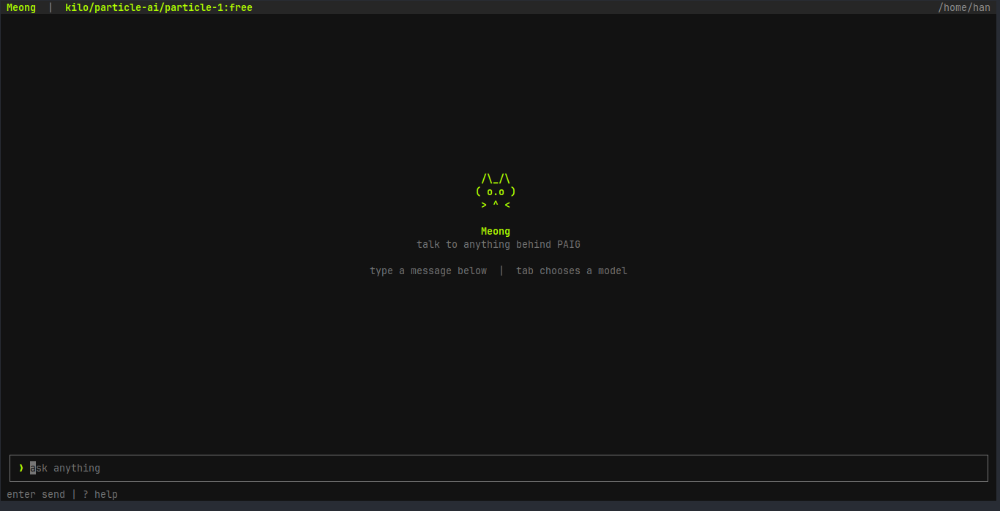
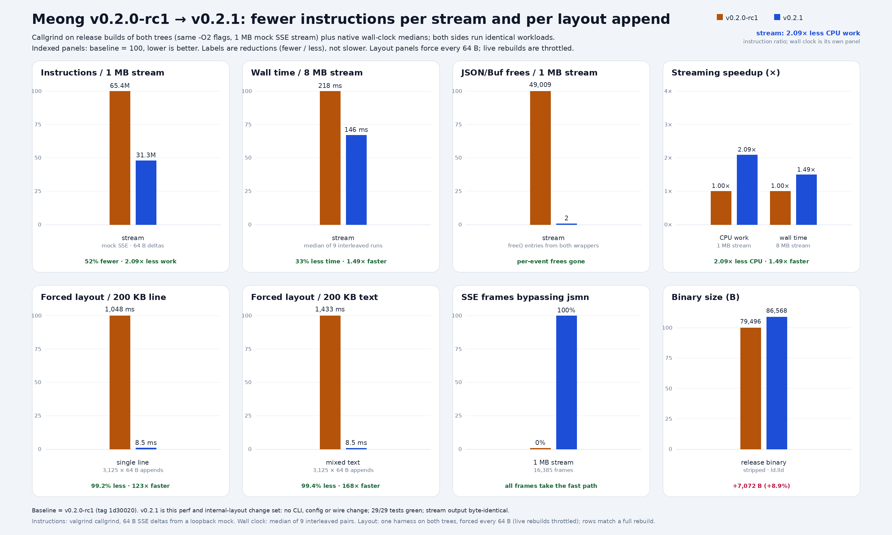

<p align="center">
  <picture>
    <source media="(prefers-color-scheme: dark)" srcset=".github/assets/meong-dark.png">
    
  </picture>
</p>

<p align="center">A very fast, clean, and small agent harness like a cat.</p>

<p align="center">
  <a href="https://github.com/Angkuh-Org/Meong/releases/latest"></a>
  <a href="https://github.com/Angkuh-Org/Meong/actions/workflows/ci.yml?query=branch%3Amain"></a>
  <a href="LICENSE"></a>
  
  
</p>

<p align="center">
  <a href="https://github.com/Angkuh-Org/Meong/blob/main/.github/assets/home.png"></a>
</p>

## Install

```sh
curl -fsSL https://raw.githubusercontent.com/Angkuh-Org/Meong/main/install.sh | sh
```

The installer verifies the release SHA-256, probes the binary, and installs to
`~/.local/bin` (`/usr/local/bin` as root). Options: [`docs/install.md`](docs/install.md).

## Run

Currently Meong need [PAIG](https://github.com/Angkuh-Org/PAIG) to run;
```sh
meong                                          # open the TUI
meong --oneshot 'hello' \
  --model cc/deepseek/deepseek-v4.1-flash      # one reply, then exit
meong --stream --oneshot 'hello' \
  --model cc/deepseek/deepseek-v4.1-flash      # print tokens as they arrive
meong --effort high                            # thinking effort: off..max
meong --list-models                            # one prefixed model id per line
```

Selection order, saved state, tools and the catalogue cache:
[`docs/models.md`](docs/models.md).
[`docs/tools.md`](docs/tools.md).

## Build

Requires `cc` and `ncursesw` headers.

```sh
./build.sh              # -> build/meong
./build.sh install      # -> $PREFIX/bin/meong (PREFIX=/usr/local by default)
./build.sh help         # commands, environment, examples
./tests/test.sh         # offline mock + pty/tmux TUI tests
```

## Docs

- [Install](docs/install.md) — installer options and PATH.
- [Usage](docs/usage.md) — keys, commands, configuration, behavior.
- [Models](docs/models.md) — selection, state, cache, capability card.
- [Tools](docs/tools.md) — tool classes, permission prompt, output bounds.
- [Performance method](docs/perf.md) — benchmark method and raw numbers.
- [Layout](docs/layout.md) — module map.
- [Release](docs/release.md) — assets and runtime requirements.

## Performance

v0.2.1 removes the per-event JSON allocations, re-wraps only the streaming
tail, and parses the common SSE frame without jsmn:



- streaming CPU: 52% fewer instructions, 2.09× less work per 1 MB
- streaming wall clock: 33% less time, 1.49× faster per 8 MB (median of 9
  interleaved pairs)
- forced layout, 3,125 × 64 B appends on 200 KB: 99.2% less work, 123× faster
- binary: 79,496 B → 86,568 B (+7,072 B)

Method and raw numbers:
[`docs/perf.md`](docs/perf.md).

## License

GPL-3.0-only. The vendored [`jsmn`](src/json/jsmn.h) is MIT.
