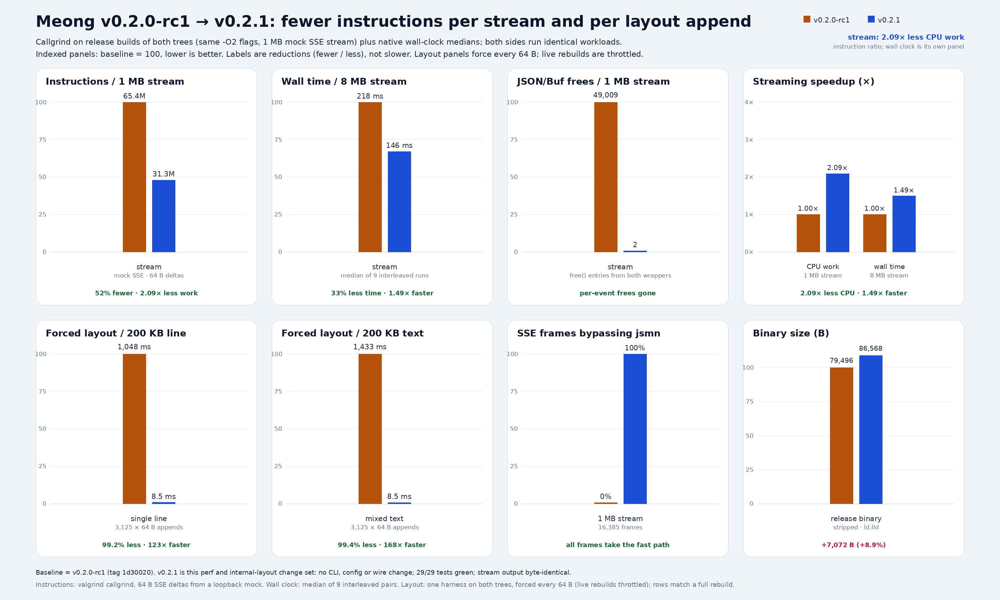

# Meong

A small terminal cat that talks to AI through [PAIG](https://github.com/Angkuh-Org/PAIG).
C11 + ncursesw, no libcurl and no TLS: it speaks plain HTTP/1.1 to the local gateway, decodes
chunked SSE itself, and streams replies into a scrolling chat.

```
  /\_/\
 ( o.o )   Meong
  > ^ <
```

## Install

```sh
curl -fsSL https://raw.githubusercontent.com/Angkuh-Org/Meong/main/install.sh | sh
```

The installer verifies the release SHA-256, probes the binary, and installs to
`~/.local/bin` (`/usr/local/bin` as root). Options: [`docs/install.md`](docs/install.md).

## Build

Requires `cc`, `ncursesw` headers, and `pkg-config` (optional; the build falls
back to `-lncursesw`).

```sh
./build.sh              # -> build/meong
./build.sh install      # -> $PREFIX/bin/meong (PREFIX=/usr/local by default)
./build.sh help         # commands, environment, examples
./tests/test.sh         # offline mock + pty/tmux TUI tests
```

A local stripped build is ~100 KB with lld; GNU bfd defaults to 64K
max-page-size on aarch64 and links ~133 KB.

Release binaries are built on Ubuntu 22.04 and need glibc 2.35+,
`libncursesw.so.6`/`libtinfo.so.6`, and a terminfo entry (`ncurses-base`).

## Development

Module map and where new code belongs: [`docs/layout.md`](docs/layout.md).
Release and prebuilt requirements: [`docs/release.md`](docs/release.md).

## Run

```sh
./build/meong             # opens the TUI
./build/meong --oneshot 'hello' --model cc/deepseek/deepseek-v4.1-flash
./build/meong --stream --oneshot 'hello' --model cc/deepseek/deepseek-v4.1-flash
./build/meong --list-models
```

`--oneshot` prints the reply and exits; add `--stream` to print tokens as they
arrive. `--list-models` prints one prefixed model id per line.

On first launch Meong fetches and caches the model list, then opens the model
picker. The last selected model is remembered in
`$XDG_CONFIG_HOME/meong/state`. Model ids must keep their PAIG backend prefix
(`cc/…`, `opencode/…`, `kilo/…`, `bob/…`, `mistral/…`); the picker handles that
for you.

## Performance

v0.2.1 removes the per-event JSON allocations, re-wraps only the streaming
tail, and parses the common SSE frame without jsmn. Release builds of both
trees, same mock workload:



- streaming CPU: 52% fewer instructions, 2.09× less work per 1 MB
- streaming wall clock: 33% less time, 1.49× faster per 8 MB (median of 9
  interleaved pairs)
- forced layout, 3,125 × 64 B appends on 200 KB: 99.2% less work, 123× faster
- binary: 79,496 B → 86,568 B (+7,072 B)

These are loopback instruction ratios, not gateway latency; the wall-clock
row uses the same local mock on both sides. Method and raw numbers:
[`docs/perf.md`](docs/perf.md).

## Keys

| Key | Action |
| --- | --- |
| `enter` | send; queue the prompt while a reply streams |
| `/` | command menu: type to filter, `up`/`down` to focus, `enter`/`tab` to complete, `esc` to close |
| `?` | open help when the composer is empty |
| `tab` | model picker (type to filter) |
| `pgup` / `pgdn` | scroll the conversation |
| `ctrl-g` / `ctrl-t` | jump to bottom / top |
| `ctrl-c` | cancel a reply; quit when idle |
| `ctrl-d` | quit on empty input |
| `ctrl-l` | redraw |
| `ctrl-o` | expand or fold the last reasoning block |
| `f1` / click `Meong` | pet the cat (live cat card) |
| `f2` / click the model | show the model capability card |
| `up` / `down` | input history |
| mouse wheel | scroll |
| click / tap thinking | expand or fold reasoning |

## Commands

Type `/` in the composer to list these in a filterable menu; `enter` or `tab`
completes the focused command, and an already-complete command runs on the
first `enter`.

| Command | Action |
| --- | --- |
| `/model [id]` | open the picker, or switch directly |
| `/models` | refresh the gateway model list |
| `/system [p]` | show, set, or clear (`off`) the system prompt |
| `/clear` | forget the conversation |
| `/retry` | regenerate the last answer |
| `/help` | help overlay |
| `/quit` | leave |

## Configuration

| Variable | Purpose |
| --- | --- |
| `MEONG_URL` / `PAIG_URL` | gateway base, default `http://127.0.0.1:8899` |
| `PAIG_HOST` / `PAIG_PORT` | used when no URL is set |
| `MEONG_MODEL` | initial model id |
| `MEONG_CONFIG_DIR` | overrides the state directory |
| `MEONG_CACHE_DIR` | overrides the model cache directory |
| `MEONG_ASCII` | force ASCII borders and symbols |
| `MEONG_NO_NERD` | hide the Nerd Font cat before `Meong` |
| `MEONG_NO_MOUSE` | disable mouse and touch input |
| `NO_COLOR` | disable color |
| `MEONG_WIRE_DEBUG` | dump parsed HTTP/SSE lines to stderr |

The gateway does not authenticate inbound requests. Keep PAIG on loopback.

## Notes

- Transport is a hand-rolled nonblocking HTTP/1.1 client, one connection per
  request. It handles chunked transfer, SSE `data:` frames, `[DONE]`, and plain
  JSON error bodies that arrive without SSE framing.
- With a Nerd Font, the header draws `nf-fa-cat` (U+EEED) before `Meong`;
  `--no-nerd` or `MEONG_NO_NERD` drops just that glyph, while `--ascii` drops
  all non-ASCII chrome.
- Clicking `Meong` (or `f1`) pets the cat: the card reacts, counts pets, and
  shows the live model, message and token totals, and mood. Typing closes it
  and still reaches the composer.
- Clicking the provider/model in the header (or `f2`) opens the capability
  card: context window, output limit, vision/tools/reasoning/caching, and cost
  when the gateway reports them. Fields the gateway did not report are listed
  as `not reported:`; values filled by PAIG from models.dev carry a
  `~ models.dev estimate` footer. `/models` refreshes both the catalogue and
  the card.
- `reasoning_content` / `reasoning` deltas are shown dimmed above the answer
  while streaming, then fold when the reply finishes; a cancelled reply stays
  open. Click or tap the thinking line — or any reasoning line — to expand or
  fold it, or press `ctrl-o` for the last reasoning block.
- Requests keep the newest ~200 KB of user/assistant text. Older turns are
  dropped, replaced by a one-line system note, and the footer shows `trimmed`;
  the visible transcript keeps everything until `/clear`.
- Code fences are rendered in a separate color; input supports UTF-8 and wide
  characters.
- Vendored [`jsmn`](src/json/jsmn.h) remains the JSON fallback; a fast delta
  scanner handles the common SSE frame, and the wrapper owns unescaping,
  surrogate pairs, and traversal.

## License

GPL-3.0-only. The vendored [`jsmn`](src/json/jsmn.h) is MIT.
