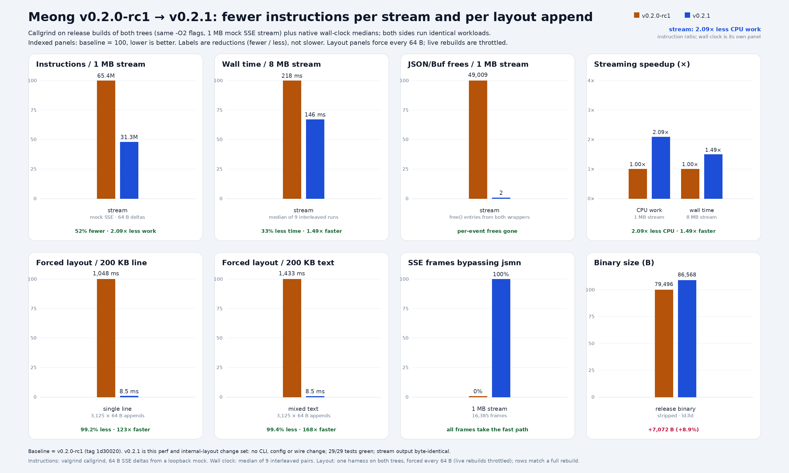

# Performance

Four passes so far. v0.2.1 removes the per-event JSON allocations, re-wraps only
the streaming tail, and parses the common SSE frame without jsmn. v0.6.0 is a
UI no-regression check: it changes the status band, footer, and header without
touching the streaming hot path.



## v0.11.0 — tool-call tree and expandable box

The tool-call UI is the feature; the stream and cache paths are unchanged. The
request path only adds a per-request `getcwd(NULL, 0)` for `x-paig-workdir`.
Both sizes below are `./build.sh` builds with the same `cc`/`ld.lld`: the
stripped binary grows 132,632 → 142,728 B (+10,096 B, +7.6%) and `.text` grows
101,612 → 111,276 B. `Msg` grows 216 → 256 B, carrying the display state
(`tool_label`, parent/position, state, timing, lines, bytes). The largest new
pieces are `tool_call_summary()` at ~2.0 KB (it parses the call's JSON to
shorten paths and patterns for display) and `draw_chat()` at 3,004 → 6,400 B
(the tree row, box, reasoning rail and closing corner, and the no-gap
attachment of a thinking-only turn to its tool rows); `draw_fit()`'s 756 B
folds into `draw_chat` after the pass below. `resume_tool_calls()` grows 368 →
1,280 B because the 1,024-byte handler error buffer moved here from
`execute_tool_call`; `run_tool()` is 1,040 B smaller, so the pair is 64 B
larger, not a stack regression. Turn stats are summed across every assistant
message between two user turns and drawn once on the trailing line of the last
assistant message, so tool rounds and thinking do not print a per-response
counter. A tool round now rebuilds from the last user message rather than the
last tool row, so the assistant's mid-stream placeholder and gap rows are
replaced by the compact final layout. The wire contract did not change: the
stored `role:"tool"` text is still only the handler result.

A follow-up codegen pass on the same tree trimmed the new draw path without
touching the wire or layout: in the `-O2 -g` twin `draw_chat()` is 1,692 →
1,600 instructions and its real frame 576 → 416 B, after `draw_fit()` took a
byte length and the tool head stopped staging `nb[64]`/`ebuf[192]`; the box rule
now uses one `wmove`+`whline_set` per row instead of one pair per column. In a
fixed 110x44 session with eight forced redraws the ncurses entry-point counter
fell 12,257 → 8,873 `wmove` and 10,862 → 7,444 `waddnstr`, replaced by 34
`whline_set` calls; this is a call count, not a wall-time measurement.
`build_request()` dropped `char cwd[4096]` for `getcwd(NULL, 0)`, cutting its
frame 4,704 → 608 B without changing the per-request header value. Final
stripped release is 142,728 B: `.text` is 96 B smaller than the pre-pass tree,
but the file is 80 B larger because the new `setcchar`/`whline_set` PLT entries
grow the dynamic tables (`.dynsym`/`.rela.plt`/`.plt`). No register headroom was
found in the changed draw code; the remaining growth is the inlined tool branch
plus the `Msg` stride, not spills.

Verification: `./tests/test.sh` is 71/71 green, including a 40x20 `LC_ALL=C`
tool-box case that bounds the body row between the top and bottom rules.
`tools_test` and `layout_truncate_test` pass under UBSan and valgrind memcheck
with no leaks or invalid accesses; the final tree also passes the full 71-check
suite under the patched 39-bit ASan/LSan runtime at `/home/han/asan39-res`
(static runtime, `detect_leaks=1`) with no reports. This pass also ran the
request path and the ASCII tool-box TUI under valgrind memcheck: 0 errors, 0
definitely lost. The build used:

```sh
export CC='clang -fsanitize=address -resource-dir=/home/han/asan39-res -g'
export DEBUG=1 ASAN_BUILD=1 ASAN_OPTIONS=detect_leaks=1 MEONG_VERSION=v0.11.0
./build.sh && ./tests/test.sh
```

## v0.6.0 — UI polish, streaming hot path unchanged

This release changes the spinner, footer, `?` help, context percentage, and
header. The SSE decoder, JSON parser, and layout engine are untouched.

| Workload | v0.5.0-rc1 | v0.6.0 | Delta |
| --- | --- | --- | --- |
| Binary size (local `-O2`, `ld.lld`) | 101,936 B | 102,016 B | +80 B (+0.08%) |
| Wall time / 8 MB SSE, run 1 | 144.8 ms | 149.2 ms | no stable direction |
| Wall time / 8 MB SSE, run 2 | 143.9 ms | 136.0 ms | no stable direction |
| TUI 1 MB stream, CPU (10 ms ticks), run 1 | 70 ms | 50 ms | no stable direction |
| TUI 1 MB stream, CPU (10 ms ticks), run 2 | 50 ms | 60 ms | no stable direction |
| TUI 1 MB stream, wall, run 1 / run 2 | 192.1 / 180.9 ms | 188.1 / 185.7 ms | within ±3% |
| Stream output | — | — | byte-identical (SHA-256) |

- Baseline: `git archive v0.5.0-rc1`, then `./build.sh`; candidate: the v0.6.0
  tree, same `-O2`, stripped, `ld.lld`. The SSE mock is
  `tests/python/bench_sse.py` (8 MB, 64 B deltas); median of 9 interleaved
  pairs per run, two full runs. The wall-time medians flip sign between runs,
  so the streaming path is unchanged within noise.
- TUI: the same 1 MB stream through a 110x40 tmux session; CPU is
  `/proc/<pid>` utime+stime at 10 ms tick resolution, wall is from the prompt
  to the completion footer; 5 interleaved pairs per run, two runs. The CPU
  medians flip between runs and the tick quantum is coarser than the expected
  header/footer cost. The frame is dominated by ncurses and the pty, so this is
  a no-regression check, not a speed claim.
- Binary growth is the new header/footer/help code. No chart is drawn because
  there is no before/after speedup to show.

## v0.2.1 — allocator reuse, tail layout, fast delta scanner

| Workload | v0.2.0-rc1 | v0.2.1 | Delta |
| --- | --- | --- | --- |
| Instructions / 1 MB SSE (callgrind) | 65.4 M | 31.3 M | 52% fewer, 2.09× less work |
| Wall time / 8 MB SSE (9 interleaved pairs) | 218 ms | 146 ms | 33% less time, 1.49× faster |
| Per-event free() entries (JSON/Buf) / 1 MB SSE | 49,009 | 2 | per-event frees gone |
| Forced layout, 200 KB single line (3,125 × 64 B) | 1,048 ms | 8.5 ms | 99.2% less, 123× faster |
| Forced layout, 200 KB mixed text (3,125 × 64 B) | 1,433 ms | 8.5 ms | 99.4% less, 168× faster |
| SSE frames bypassing jsmn | 0 | 16,385 | all frames take the fast path |
| Binary size | 79,496 B | 86,568 B | +7,072 B (+8.9%) |

- The fast scanner handles all 16,385 frames in the 1 MB run (16,384 deltas plus
  the usage chunk). The full parser remains the fallback for errors, odd shapes
  and malformed input.
- Layout numbers are 3,125 forced appends of 64 B into a 200 KB message, median
  of 5 runs. The harness calls `layout_build` on every append to isolate the
  rewrap cost; the live client throttles streaming rebuilds to ~11/s, so this is
  a frame-time bound, not stream duration. The incremental rows are compared
  field-for-field against a full rebuild at every append
  (`tests/c/layout_stream_test.c`).
- Stream output is byte-identical to the baseline on the 64 KB benchmark stream
  and on `mock/split` (split UTF-8, code fence, reasoning).

### What changed

- `JDoc` keeps its token+skip block across events; `App` and `CliStream` reuse
  one `JDoc` and one `Buf`. Per-event allocator calls drop to zero.
- `layout_build` checkpoints the last wrapped row and re-wraps only that row
  plus the new bytes. Width changes and reason growth invalidate the cursor.
- `jdelta_scan` walks the OpenAI delta/usage shape directly and returns -1 on
  anything it cannot prove; the caller then runs the old jsmn path. A 10,000
  random-byte differential fuzz backs the fallback contract.
- `start_generation` and `msgs_clear` reset `layout_from`, so rows for messages
  removed by `/retry` or `/clear` cannot outlive their text.

### Method

- Baseline: `git archive v0.2.0-rc1 | tar -x -C /tmp/meong-base-1d30020`,
  then `./build.sh`; candidate: `./build.sh` on this tree. Both are `-O2`,
  stripped, and linked with `ld.lld`; only the source changed.
- SSE: a loopback mock (`tests/python/bench_sse.py`) emits 64 B content deltas
  with chunked transfer; 1 MB for callgrind and 8 MB for wall clock (median of
  9 interleaved baseline/candidate pairs of `--stream --oneshot`). The client's
  per-event `fflush` is part of the workload on both sides.
- Callgrind: `valgrind --tool=callgrind ./build/meong-g ...`; profile an
  `-O2 -g` twin, never the stripped release binary. The free() row counts the
  libc `free` entries reached from `jdoc_free` and `buf_free`: the baseline
  frees the token+skip pair and the event Buf per frame, the candidate only at
  teardown.
- Layout: `tests/c/layout_bench.c`, compiled against each tree. The same source
  drives `layout_from` and `layout_build`, so it measures the baseline's full
  rewrap and the candidate's tail cursor without conditional compilation. It
  forces a rebuild on every append; the live client's 90 ms throttle is not part
  of this harness.
- `./tests/test.sh` is 29/29 green; the same suite passes under the patched
  39-bit ASan/LSan runtime at `/home/han/asan39-res`.

### Caveats

- Instruction counts are loopback client-side work, not gateway latency. The
  Python mock can saturate before the client, so wall clock is a lower bound.
- The binary grew 8.9%: the fast scanner and the layout cursor are real code.
  The trade is 2.09× less streaming work for 7 KB.
- The layout panels are a forced per-append worst case. The live client only
  rebuilds while streaming when 90 ms have passed, so the user-visible effect
  is a lower frame-time bound, not a shorter stream.
- Reasoning growth still invalidates the layout cursor, so a reasoning-heavy
  stream re-wraps the message while reasoning arrives; the tail cursor covers
  answer text.

## v0.1.1 — per-byte calls and full-history relayout

The v0.1.1 pass removed two structural costs: the SSE decoder and JSON string
unescape called `buf_addc` once per byte, and every streaming redraw re-wrapped
the whole transcript. Both are gone; the compiler flags did not change. This
section used a different mock (`mock_paig.py`) and tree; compare rows only
within a section.


| Workload | v0.1.0 | v0.1.1 | Delta |
| --- | --- | --- | --- |
| Instructions / 1 MB SSE (callgrind) | 104.7 M | 32.4 M | 69% fewer, 3.23× less work |
| Wall time / 8 MB SSE | 285 ms | 140 ms | 51% less time, 2.04× faster |
| Allocator Ir / 1 MB SSE | 8.95 M | 4.97 M | 44% fewer |
| Layout redraw, 201 messages | 4.60 ms | 0.010 ms | 99.8% less, 460× less work |
| Full layout, 200 KB message | 4.84 ms | 1.27 ms | 74% fewer |
| `draw_slice`, 117 ASCII chars | 13.32 µs | 8.82 µs | 34% fewer |
| Binary size | 78,128 B | 78,792 B | +664 B (+0.85%) |

Method: baseline `git archive v0.1.0`, candidate on the release branch, same
`-O2` flags and `ld.lld`. SSE used a loopback chunked mock; wall clock was the
median of 9 interleaved runs. Layout and `draw_slice` used one harness compiled
against both trees. The `draw_slice` number needs a pty at least as wide as the
line (120 columns here). The skip table has a differential harness in `tests/`.
`-O3` and LTO were measured and rejected: no gain after the structural fix, and
GCC LTO does not link with `ld.lld` on this host.
