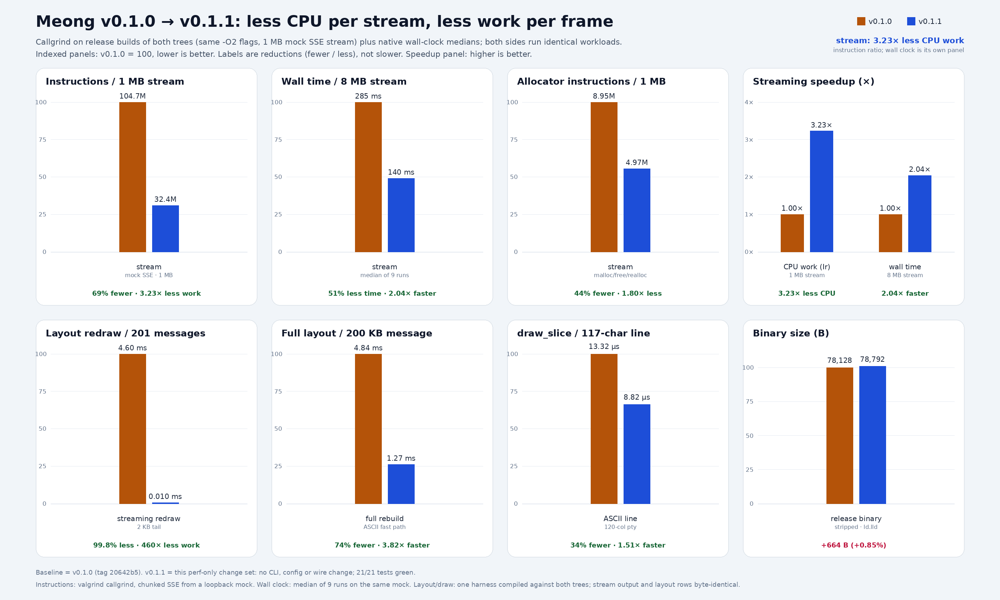

# Performance

Meong's benchmark results. Only passes with a stable improvement are listed;
feature releases without a measured gain are not included. Numbers are local
client-side work, not gateway latency.

| Pass | Headline |
| --- | --- |
| v0.2.1 | 52% fewer instructions; 1.49× faster 8 MB stream; 123× faster forced layout |
| v0.1.1 | 69% fewer instructions; 2.04× faster 8 MB stream |

## v0.2.1 — allocator reuse, tail layout, fast delta

| Workload | v0.2.0-rc1 | v0.2.1 | Delta |
| --- | --- | --- | --- |
| Instructions / 1 MB SSE (callgrind) | 65.4 M | 31.3 M | 52% fewer, 2.09× less work |
| Wall time / 8 MB SSE (9 interleaved pairs) | 218 ms | 146 ms | 33% less time, 1.49× faster |
| Per-event `free()` entries / 1 MB SSE | 49,009 | 2 | per-event frees gone |
| Forced layout, 200 KB single line (3,125 × 64 B) | 1,048 ms | 8.5 ms | 99.2% less, 123× faster |
| Forced layout, 200 KB mixed text (3,125 × 64 B) | 1,433 ms | 8.5 ms | 99.4% less, 168× faster |
| SSE frames bypassing jsmn | 0 | 16,385 | all frames take the fast path |
| Binary size | 79,496 B | 86,568 B | +7,072 B (+8.9%) |

- `JDoc` keeps its token+skip block across events; `App` and `CliStream`
  reuse one `JDoc` and one `Buf`, so per-event allocator calls drop to zero.
- `layout_build` re-wraps only the last row plus new bytes; width changes and
  reasoning growth invalidate the cursor.
- `jdelta_scan` walks the common delta/usage shape and returns `-1` on
  anything it cannot prove; the caller then runs the jsmn (vendored JSON
  tokenizer) path. A 10,000 random-byte differential fuzz backs the fallback.
- `start_generation` and `msgs_clear` reset `layout_from`, so removed
  messages cannot leave stale rows.

Stream output is byte-identical to the baseline on the 64 KB benchmark stream
and on `mock/split` (split UTF-8, code fence, reasoning).

## v0.1.1 — per-byte calls and full-history relayout

| Workload | v0.1.0 | v0.1.1 | Delta |
| --- | --- | --- | --- |
| Instructions / 1 MB SSE (callgrind) | 104.7 M | 32.4 M | 69% fewer, 3.23× less work |
| Wall time / 8 MB SSE | 285 ms | 140 ms | 51% less time, 2.04× faster |
| Allocator Ir / 1 MB SSE | 8.95 M | 4.97 M | 44% fewer |
| Layout redraw, 201 messages | 4.60 ms | 0.010 ms | 99.8% less, 460× less work |
| Full layout, 200 KB message | 4.84 ms | 1.27 ms | 74% fewer |
| `draw_slice`, 117 ASCII chars | 13.32 µs | 8.82 µs | 34% fewer |
| Binary size | 78,128 B | 78,792 B | +664 B (+0.85%) |

The pass removed per-byte `buf_addc` calls in the SSE decoder and JSON string
unescape, and full-history rewrap on every streaming redraw. Flags did not
change.

## Method

- **Builds.** Baseline: `git archive <tag> | tar -x -C /tmp/...`, then
  `./build.sh`. Candidate: `./build.sh` on the tree under test. Both are
  `-O2`, stripped, and linked with `ld.lld`; only the source changes.
- **SSE.** `tests/python/bench_sse.py` emits 64 B content deltas with chunked
  transfer: 1 MB for callgrind, 8 MB for wall clock, median of 9 interleaved
  pairs. The client's per-event `fflush` is part of the workload. v0.1.1 used
  `mock_paig.py` and a different tree; compare rows only within its section.
- **Callgrind.** `valgrind --tool=callgrind ./build/meong-g ...` on an
  `-O2 -g` twin, never the stripped release binary. `Ir` means instructions
  retired. The `free()` row counts libc `free` entries reached from
  `jdoc_free` and `buf_free`.
- **Layout.** `tests/c/layout_bench.c`, compiled against each tree. It forces
  a rebuild on every append; the live client's 90 ms throttle is not part of
  the harness.
- **Tests.** `./tests/test.sh`; the same suite runs under the patched 39-bit
  ASan/LSan runtime at `/home/han/asan39-res` (`CC='clang -fsanitize=address
  -resource-dir=/home/han/asan39-res -g' DEBUG=1 ASAN_BUILD=1`).

## Caveats

- Instruction counts are loopback client-side work, not gateway latency. The
  Python mock can saturate before the client, so wall clock is a lower bound.
- The v0.2.1 binary grew 8.9%: the fast scanner and layout cursor are real
  code. The trade is 2.09× less streaming work for 7 KB.
- Layout numbers are a forced per-append worst case. The live client rebuilds
  while streaming only after 90 ms, so the user-visible effect is a lower
  frame-time bound, not a shorter stream.
- Reasoning growth still invalidates the layout cursor; the tail cursor
  covers answer text.
- Local build sizes are not release sizes.

## See also

- [Usage](usage.md), [Layout](layout.md), [Tools](tools.md),
  [Release](release.md)
