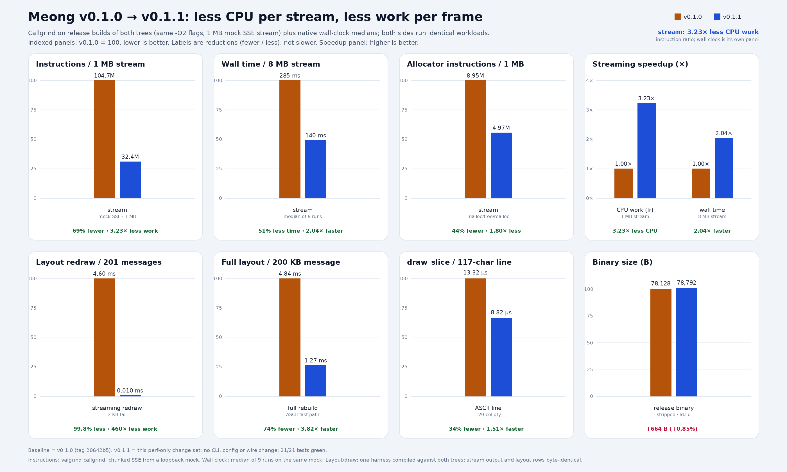

# Performance

The v0.1.1 pass removed two structural costs from the client: the SSE decoder
and the JSON string unescape called `buf_addc` once per byte, and every
streaming redraw re-wrapped the whole transcript. Both are gone; the compiler
flags did not change.

## Results

| Workload | v0.1.0 | v0.1.1 | Delta |
| --- | --- | --- | --- |
| Instructions / 1 MB SSE (callgrind) | 104.7 M | 32.4 M | 69% fewer, 3.23× less work |
| Wall time / 8 MB SSE | 285 ms | 140 ms | 51% less time, 2.04× faster |
| Allocator Ir / 1 MB SSE | 8.95 M | 4.97 M | 44% fewer |
| Layout redraw, 201 messages | 4.60 ms | 0.010 ms | 99.8% less, 460× less work |
| Full layout, 200 KB message | 4.84 ms | 1.27 ms | 74% fewer |
| `draw_slice`, 117 ASCII chars | 13.32 µs | 8.82 µs | 34% fewer |
| Binary size | 78,128 B | 78,792 B | +664 B (+0.85%) |

## Method

- Baseline: `git archive v0.1.0 | tar -x -C /tmp/meong-base`, then
  `./build.sh`; candidate: `./build.sh` on the release branch. Both are `-O2`,
  stripped, and linked with `ld.lld`; only the source changed.
- SSE: a loopback mock emits `text/event-stream` with chunked transfer, 1 MB
  for callgrind and 8 MB for wall clock. Wall clock is the median of 9
  interleaved runs of `--stream --oneshot`.
- Callgrind: `valgrind --tool=callgrind ./build/meong-g ...`; profile a `-g`
  twin, never the stripped release binary.
- Layout and `draw_slice`: one harness compiled against both trees. The
  `draw_slice` number needs a pty at least as wide as the line (120 columns
  here); on an 80-column pty ncurses takes its error path and the fast path
  disappears.
- Skip table: a differential harness runs the old recursive `jskip` next to
  the cached table over 509 JSON documents, including multi-field model
  objects and nested arrays. It is part of `tests/`.

## Caveats

Instruction counts are loopback client-side work, not gateway latency. The
wall-clock row uses the same local mock on both sides; the Python server can
saturate before the client, so the speedup is a lower bound.

`-O3` and LTO were measured and rejected: no gain after the structural fix,
and GCC LTO does not link with `ld.lld` on this host.
